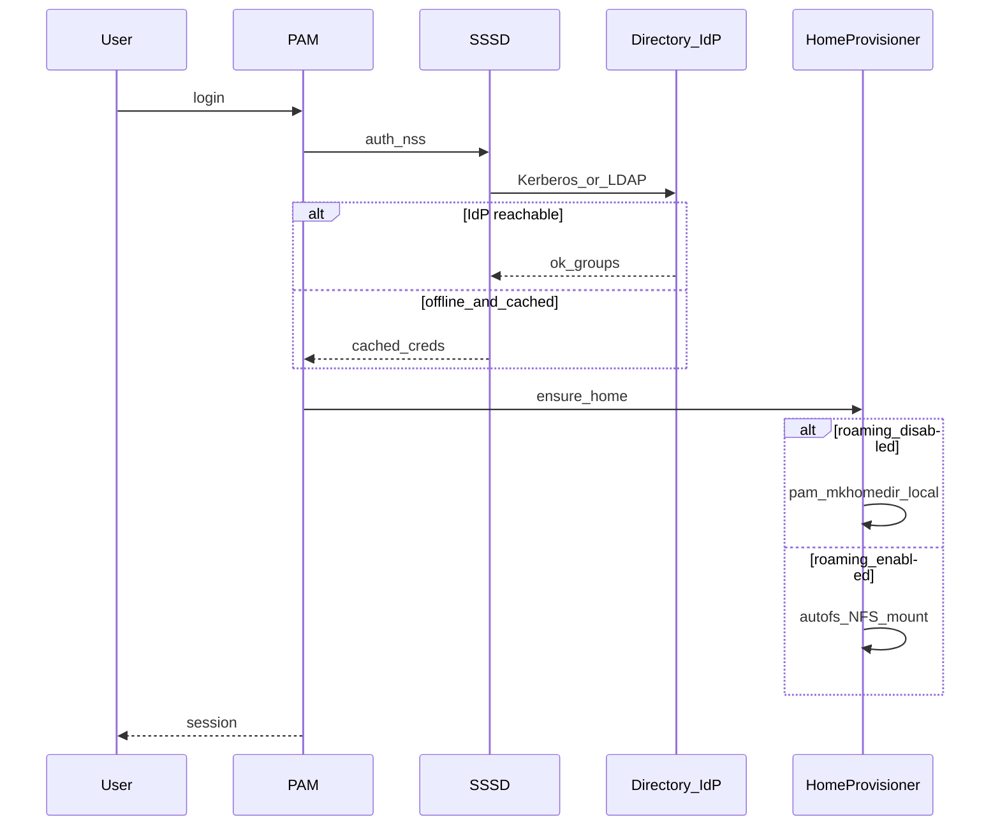

# Directory-Client Modul (v1)

## Decisions (locked)

- **v1 = Client only** — Join zu bestehendem FreeIPA/LDAP/AD (BYO). Kein LLDAP/FreeIPA-Server im Baum; Server später als Geschwister `directory-server` wenn nötig.
- **Homes = lokal zuerst** — `pam_mkhomedir` legt `/home/<user>` beim ersten Login an. `roaming.enable` schaltet NFS/autofs ein; Default `false` (Gaming/Home).
- **Kein Hybrid-Sync in v1** — zu viele Integrity-/Escape-Fallen; entweder lokal oder NFS-Home, nicht beides mit Background-Sync.
- Placement: [`nixos/modules/security/directory-client/`](nixos/modules/security/directory-client/) — analog zu [`ssh-manager`](nixos/modules/security/ssh-manager/), parallel zu Core [`user`](nixos/core/base/user/) (lokale Accounts bleiben Break-glass + NCC-Rollen).

## Module tree

```
nixos/modules/security/directory-client/
  default.nix                 # metadata + conditional imports
  options.nix
  template-config.nix         # enable = false
  config.nix                  # SSSD / PAM / krb5 wiring
  auth.nix                    # PAM stack, mkhomedir, offline cache
  roles.nix                   # Directory-Gruppe → Policy (sudo/polkit/groups)
  roaming.nix                 # mkIf roaming.enable: NFS/autofs + mount opts
  hardening.nix               # escape / path / umask / sticky home rules
  join.nix                    # join/leave helpers (keytab path, status)
  commands.nix                # ncc directory …
  api.nix                     # status helpers for other modules
  README.md
  CHANGELOG.md
  ai/manifest.nix
  doc/
    usage.md
    cli.md
    architecture.md
    security.md               # escape, integrity, threat model
    ai-overview.md
  ui/gui/page.py              # enable, provider, roaming toggle, join status (later ok)
tests/
  directory-client/
    test_options_shape.py     # oder nix eval gates
    test_role_mapping.py
    # no tests under nixos/
```

CLI domain: `directory` (verbs: `status`, `join-check`, `roles`, `roaming-status`).

## Data flow



First login auf neuem PC (roaming aus): IdP liefert uid/gid/Gruppen → SSSD → `pam_mkhomedir` erstellt leeres `/home/<user>` mit korrektem Owner/Mode → Skeleton aus `/etc/skel` → fertig. Kein „User-Fetch“ vom anderen PC.

First login (roaming an): Autofs mountet `server:/export/homes/<user>` (oder IPA-automount). Existiert der Export noch nicht → provision am Server (Admin/Skript), nicht client-seitiges wildes Anlegen fremder Pfade.

## Options shape (template)

```nix
{
  enable = false;
  provider = "freeipa";       # freeipa | ldap | ad
  domain = "";
  server = "";
  realm = "";                 # Kerberos; oft UPPER(domain)
  certificateFile = "";       # IPA CA / LDAP TLS
  keytabPath = "/etc/krb5.keytab";

  offline.cacheCredentials = true;

  homes = {
    mode = "local";           # local | roaming  (roaming.require enable)
    createLocal = true;       # pam_mkhomedir
    basePath = "/home";
    skeleton = "/etc/skel";
    permissions = "0700";     # hart: keine world-readable Homes
  };

  roaming = {
    enable = false;
    backend = "nfs";          # nfs only in v1
    server = "";
    exportRoot = "/export/homes";
    sec = "krb5p";            # Prefer encrypted NFS when Kerberos
  };

  roles = {
    # map IdP group CN/DN → NCC-ähnliche Policy
    # guest | restricted-admin | admin | virtualization | none
    map = {
      # "schule-schueler" = "guest";
      # "schule-it" = "restricted-admin";
    };
    defaultRole = "guest";
    allowUnmappedLogin = false;  # unbekannte Gruppen → deny session
  };

  breakGlass = {
    # dokumentiert: lokale users.users bleiben; Modul darf sie nicht entfernen
    requireLocalAdmin = true;
  };
}
```

## Security: Escape, Trennung, Integrität

Dedicated [`doc/security.md`](nixos/modules/security/directory-client/doc/security.md) — Kernregeln im Code (`hardening.nix` + `roles.nix`):

**1. Identity boundary**
- Directory-User sind NSS-User, nicht in `users.users.*` deklariert.
- Lokale Break-glass-Admins (Core `user`) bleiben; Join darf `/etc/passwd`-Locals nicht wischen (`users.mutableUsers` Policy dokumentieren; Default: Locals behalten).
- `allowUnmappedLogin = false`: ohne gemappte Rolle kein Desktop/SSH-Session (PAM `access` / SSSD `access_provider`).

**2. Privilege escape**
- Sudo **nur** über explizites Rollen-Map → `security.sudo.extraRules` / IPA-sudo (v1: lokale sudoers aus Map, nicht „Domain-User = wheel“).
- Default-Rolle `guest`: kein sudo, keine docker/libvirt-Gruppen, kein polkit admin.
- Kein automatisches `wheel` für Directory-Gruppen.
- SSH: optional `sss_ssh_authorizedkeys`; Password-SSH für Domain-User default aus wenn Core/`ssh-manager` lockdown aktiv (nur dokumentieren + assert, nicht sshd neu erfinden).

**3. Home / Daten-Trennung**
- Home-Mode `0700`, Owner = Directory-uid; Sticky auf `/home`.
- Roaming: Mount mit `nosuid,nodev` (und wo sinnvoll `noexec` nur für restriktive Rollen — Desktop braucht exec → default ohne `noexec`, dafür `nosuid,nodev`).
- NFS `sec=krb5p` wenn Provider Kerberos; kein `sec=sys` in Defaults.
- Client darf **nicht** beliebige Server-Pfade mounten: Export-Root + Username-Template fixed (`${exportRoot}/${user}`), kein User-kontrollierter Mount-Pfad.
- Cross-user: kein shared group-write auf Homes; `umask 0077` in PAM session für gemappte Nicht-Admin-Rollen.

**4. First-login / „User fetchen“**
- Lokal: nur Skeleton + leeres Home — **kein** Pull von PC-A.
- Roaming: Daten leben auf dem File-Server; „Fetch“ = Autofs-Mount. Provision neuer Homes: Server-seitig (Skript/Doku), Client mountet read-write nur eigenes Home.
- Integrity: bei Roaming optional `root_squash` / Server-Export-Optionen in Docs; Client prüft nach Mount `stat` Owner == login-uid, sonst Session abort (hardening hook).

**5. Offline / Master down**
- `cacheCredentials = true` für kurze Ausfälle.
- Ohne Cache + IdP down → Login fail (außer Break-glass lokal).
- Kein silent Privilege-Escalate im Cache-Modus (SSSD cached groups; Map bleibt deterministisch).

**6. Secrets**
- Keytab/Bind-Password nie im Nix-Store: Pfade + `environmentFile` / sops-Hinweise wie Enterprise-SSSD-Pattern; Join-Flow schreibt Keytab nach `/etc` mit `0600`.

## Integration with existing NCC

- Core [`user`](nixos/core/base/user/): unverändert SSOT für lokale Rollen; Directory mappt auf **dieselbe Rollen-Semantik** (`guest` / `restricted-admin` / …) via [`api.nix` capabilities](nixos/core/base/user/api.nix) wo sinnvoll (Dokument + optionale `getModuleApi "user"` Nutzung für Capability-Listen — keine relativen Imports).
- [`ssh-manager`](nixos/modules/security/ssh-manager/): keine harte Abhängigkeit; Docs „nach Join: lockdown“.
- Network/DNS/Zeit: Docs-Checkliste (Kerberos braucht NTP); ggf. soft warn in `config.nix` wenn `localization`/time offensichtlich falsch — kein Cross-Module-Hardwire.
- Gates: neues Modul muss Shape/Docs/Surfaces erfüllen ([`docs/developing/new-module.md`](docs/developing/new-module.md)); Tests nur unter `tests/`.
- Domains-Tabelle: Eintrag in [`docs/domains.md`](docs/domains.md) + Feature-Zeile in [`docs/features.md`](docs/features.md).

## Implementation phases

1. **Skeleton** — tree, options, template `enable=false`, metadata, empty `config.nix` stubs, docs stubs, `ai/manifest.nix`, gates green.
2. **Auth core** — SSSD settings per `provider`, PAM mkhomedir, offline cache, `ncc directory status`.
3. **Roles + hardening** — group map, sudo/polkit, home 0700, unmapped deny, Owner-check hook.
4. **Roaming** — `roaming.nix` NFS/autofs hinter `mkIf`, mount hardening, usage docs (Server-Export out of scope).
5. **CLI/GUI** — join-check, roles show; GUI page enable/roaming/status (kann nach CLI kommen).
6. **Tests + gates** — option shape, role mapping unit tests; `bash tests/run-gates.sh` exit 0.

Out of v1: FreeIPA server, Replica/HA, PXE/diskless, AD GPO, Hybrid-Sync, SMB roaming.

## Threat model (kurz, in security.md)

| Threat | Mitigation |
|--------|------------|
| Schüler/User wird root | kein wheel; sudo nur gemappte Admin-Rolle |
| User mountet fremdes NFS | fixed export template; kein user mount helper |
| Home world-readable | 0700 + umask |
| IdP spoof | TLS CA pin / IPA cert; DNS/NTP checklist |
| Master tot → Lockout | Break-glass lokal + optional credential cache |
| Config im Store leaked Bind-PW | nur Pfade/env files |

## Success criteria

- Modul disabled by default; Enable + IdP-Daten joinen einen Host deklarativ (Keytab-Schritt manuell/CLI dokumentiert).
- Erster Login ohne Roaming erzeugt lokales Home; zweiter PC = neues leeres Home (kein stilles Daten-Leak).
- Mit Roaming: gleiches Home auf PC2 nach Mount; Owner-Mismatch bricht Session.
- Unmapped Directory-User kommt nicht rein; gemappter `guest` hat kein sudo.
- `tests/run-gates.sh` grün; Docs erklären Home-Lab (1 IdP-Server) und Firmen-BYO.