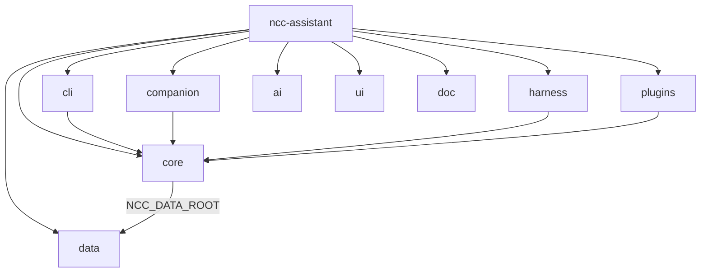

# ncc-assistant Tree — Surfaces oben, kein Sammel-Package

## Kritik am letzten Plan

Ein Ordner `assistant/` (oder `ncc_assistant/` / `python/`) ist wieder nur ein Mülleimer. Du willst **Companion, Harness, Plugins, Data usw. direkt unter dem Modul** — nicht nochmal eingepackt.

## Nix statt Python? — Nein (Non-Goal)

Alles nach Nix „portieren“ wäre **schlechter**, nicht besser:

| Schicht | Richtig in |
|---------|------------|
| Options, schedules, packaging, discovery, system-update | **Nix** (`*.nix`, `lib/`, `package.nix`) |
| Catalogs (agents/mcp/playbooks/skills) | **Daten** (`data/*.json|md`) |
| Companion (Qt), LLM, MCP client, harness adapters, CLI verbs | **Python** (Top-Level-Packages) |

Nix evaluiert Config und baut Store-Pfade — es ist keine Runtime für Chat-Streams, PySide6-Fenster oder Agent-Tool-Loops. Ein Port wäre ein Rewrite in einer anderen Sprache (Go/Rust/…) plus trotzdem Packaging in Nix — kein Gewinn für den Tree.

**Besser:** Tree wie unten trennen; Nix bleibt dünn (wire + package), Python nur in klaren Surface-/Core-Ordnern, Daten nur in `data/`.

## Zielbaum

```
ncc-assistant/                    # Nix-Modul (discovery)
  default.nix  options.nix  commands.nix  package.nix  …
  lib/                            # Nix helpers
  doc/                            # Docs
  ai/                             # Domain-AI-Pack (NCC-Konvention)
  ui/gui/                         # Control-Center page
  data/                           # catalogs only
    agents/*.json
    mcp/*.json
    playbooks/*.json
    skills/*.md
    system.md

  companion/                      # Desktop companion surface (war companion.py + themes/store)
    __init__.py                   # run_companion
    window.py  …
  harness/                        # coding harness adapters
  plugins/                        # feature plugins (doomscroll, …)
  core/                           # shared runtime (llm, session, paths, agent, mcp, …)
  cli/                            # Entrypoint: python -m cli  (argparse / verbs)
    __main__.py
```

Kein `python/`. Kein `ncc_assistant/`. Kein `assistant/`.

| Top-Level | Zweck |
|-----------|--------|
| `companion/` | Desktop-Fenster / Avatar-UI |
| `harness/` | Qwen/DSH/native adapters |
| `plugins/` | Feature plugins |
| `core/` | Gemeinsame Logik (nicht surface-spezifisch) |
| `cli/` | CLI-Entrypoint (`-m cli`) |
| `data/` | JSON/MD catalogs |
| `ai/` / `ui/` / `doc/` / `lib/` | NCC-Modul-Konvention |



## Packaging

[`package.nix`](nixos/modules/specialized/ncc-assistant/package.nix):

- Modulroot (bzw. die Package-Ordner) nach `$out` kopieren: `companion`, `harness`, `plugins`, `core`, `cli`, `data`, …
- `PYTHONPATH=$out` (alle Top-Level-Packages importierbar)
- Wrapper: `python -m cli …` (nicht `-m ncc_assistant`)
- `NCC_DATA_ROOT=$out/data`

Imports (Richtung):

- `from core.paths import …`
- `from companion import run_companion`
- `from harness.resolve import …`
- `from plugins import …`

Was nach `core/` wandert: alles Shared (llm, session, agent, marketplace, agent_templates, playbooks loader, gui*, tray, …). Was surface-spezifisch ist, bleibt in `companion/` / `harness/` / `plugins/`.

GUI Control-Center-Seite bleibt `ui/gui/page.py` (NCC-Shell); Companion ist absichtlich **nicht** unter `ui/`.

## Gate

1. Verboten unter dem Modul: `python/`, `ncc_assistant/`, `assistant/`  
2. Pflicht: `companion/`, `core/`, `cli/`, `data/{agents,mcp,playbooks,skills}`  
3. Keine Catalog-`*.json` unter `core/` / `companion/` / …  

## Migration

1. Catalogs → `data/`; `prompts/` → `data/skills`  
2. `python/ncc_assistant/` aufteilen → Top-Level `companion/`, `harness/`, `plugins/`, `core/`, `cli/`  
3. `python/` löschen  
4. Imports + `package.nix` + Tests umbiegen  
5. `doc/layout.md` + Gate + `bash tests/run-gates.sh`  

Größerer mechanischer Rename als nur Ordner-hoisten — bewusst, damit der Tree der mentalen Modell-Trennung entspricht.
