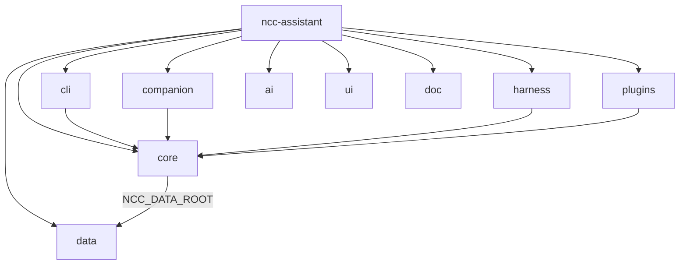

# ncc-assistant Tree — Surfaces oben, kein Sammel-Package

## Kritik am letzten Plan

Ein Ordner `assistant/` (oder `ncc_assistant/` / `python/`) ist wieder nur ein Mülleimer. Du willst **Companion, Harness, Plugins, Data usw. direkt unter dem Modul** — nicht nochmal eingepackt.

Der Ist-Zustand gibt das her: `python/ncc_assistant/` liegt **70 `.py` auf einer Ebene** — `companion.py` (126 KB), `gui_pages.py` (98 KB), `gui.py` (91 KB), `cli.py` (75 KB) direkt neben `paths.py`, `llm.py`, `session.py`. Oberflächen und Kern sind nicht trennbar, weil sie im selben Ordner wohnen.

## Nix statt Python? — Nein (Non-Goal)

Alles nach Nix „portieren" wäre **schlechter**, nicht besser:

| Schicht | Richtig in |
|---------|------------|
| Options, schedules, packaging, discovery, system-update | **Nix** (`*.nix`, `lib/`, `package.nix`) |
| Catalogs (agents/mcp/playbooks/skills) | **Daten** (`data/*.json|md`) |
| Companion (Qt), LLM, MCP client, harness adapters, CLI verbs | **Python** (Top-Level-Packages) |

Nix evaluiert Config und baut Store-Pfade — es ist keine Runtime für Chat-Streams, PySide6-Fenster oder Agent-Tool-Loops. Ein Port wäre ein Rewrite in einer anderen Sprache (Go/Rust/…) plus trotzdem Packaging in Nix — kein Gewinn für den Tree.

**Besser:** Tree wie unten trennen; Nix bleibt dünn (wire + package), Python nur in klaren Surface-/Core-Ordnern, Daten nur in `data/`.

## Zielbaum

```
ncc-assistant/                    # Nix-Modul (discovery)
  default.nix  options.nix  commands.nix  package.nix  …
  lib/                            # Nix helpers (discover-domain-ai, discover-modules-index)
  doc/                            # Docs (usage.md, cli.md, layout.md)
  ai/                             # Domain-AI-Pack (Gate-Pflicht: ai/manifest.nix)
  ui/gui/page.py                  # Control-Center page — NCC-Shell
  data/                           # ONLY Daten, kein Code
    agents/*.json                 # war python/ncc_assistant/templates/agents (29)
    mcp/*.json                    # war python/ncc_assistant/templates/mcp (4)
    playbooks/*.json              # war python/ncc_assistant/playbooks (4)
    eval/cases.json               # war python/ncc_assistant/eval/cases.json
    prompts/system.md             # war prompts/system.md
    prompts/skills/*.md           # war prompts/skills (11)
    knowledge/README.md           # erklärt $out/knowledge (built, nicht source)

  companion/                      # Desktop companion surface (war companion.py + themes/store)
    __init__.py                   # run_companion
    window.py  themes.py  store.py  feed.py  …
  harness/                        # coding harness adapters (war python/ncc_assistant/harness)
  plugins/                        # feature plugins (doomscroll, morning_brief)
  core/                           # shared runtime (llm, session, paths, agent, mcp, permissions, …)
  cli/                            # Entrypoint: argparse / verbs
    __main__.py
```

Kein `python/`. Kein `ncc_assistant/`. Kein `assistant/`.

| Top-Level | Zweck |
|-----------|--------|
| `companion/` | Desktop-Fenster / Avatar-UI (Qt, eigene Surface) |
| `harness/` | Qwen/DSH/native adapters |
| `plugins/` | Feature plugins |
| `core/` | Gemeinsame Logik (nicht surface-spezifisch) |
| `cli/` | CLI-Entrypoint |
| `data/` | JSON/MD catalogs only |
| `ai/` / `ui/` / `doc/` / `lib/` | NCC-Modul-Konvention |



Konventions-Präzedenz ist da: `validate-module-shape.sh` verlangt pro Modul `template-config.nix`, `ai/manifest.nix`, `doc/usage.md` (das `ai/`/`doc/` also Pflicht, kein Wunsch). Flache Oberflächen-Ordner existieren bereits: `chronicle/` (`plugins/ analysis/ handlers/ …`), `ai-workspace/` (`llm/ services/ schemas/`), `nixify/` (`data/`).

## Korrekturen gegen den gemessenen Ist-Zustand

Die erste Fassung des Plans ging von drei Dingen aus, die nicht stimmen. Messwerte (2026-10-23, Working Tree):

| Annahme im alten Plan | Gemessen | Folge |
|---|---|---|
| `PYTHONPATH=Modulroot` | `package.nix:23-37` baut `appRoot = pkgs.runCommand "ncc-assistant-src"`, kopiert `python/ncc_assistant` → `$out/ncc_assistant` (`:24`), `prompts` (`:25`), `knowledge` (discoveriert), `AI_KNOWLEDGE.md`, `ncc_gui` (von gui-engine). `PYTHONPATH="${appRoot}"` (`:252`). Die Modulquelle war **nie** auf dem Pfad. | Modulroot auf PYTHONPATH würde `ai/ doc/ lib/ ui/` zu importierbaren Namespace-Ordnern machen — `lib/` enthält ausschließlich `.nix`. Staging-Root bleibt, Inhalt ändert sich. |
| Catalogs liegen schon in `data/` | `data/` enthält **nur leere Ordner** (`data/playbooks`, `data/templates/mcp`) und ist **nicht in git**: `git ls-files …/data` → leer. Ein Klon hat kein `data/`. | `data/` entsteht erst durch den Umzug; Gate auf „Pflicht-Ordner" zieht vorher nicht. |
| `prompts/` ist ein Stub, „weg" damit | `prompts/` ist der **lebende** Prompt-Katalog: `package.nix:25` (`cp -r ${./prompts} $out/prompts`), `package.nix:171` (`NCC_PROMPTS_ROOT`), `config.py:196-200` (Default `root/prompts`), `agent_templates.py:278` (liest die Skill-MDs). | Ohne Env-Umhängung verliert das gepackte Assistant **still** seine Skills. Umbenennen ja — aber als Daten-Umzug mit Env-Contract, nicht als Löschen. |

## Blast-Radius außerhalb des Moduls (der teure Teil)

Der Rename ist **nicht** auf `ncc-assistant` begrenzt. 58 Dateien außerhalb des Pakets referenzieren `ncc_assistant` (`.py|.sh|.nix|.md`, ohne `docs/todo`). Tragend:

**1. `nixos/core/management/gui-engine/python/ncc_gui/reload.py`** hartcodiert das Tupel `("ncc_gui", "ncc_assistant")` an 6 Code-Stellen — `:195`, `:201`, `:252`, `:269`, `:284` (+ Docstring `:8`, `:265`) — für Modul-Cache-Purge und Store-Pfad-Erkennung des Hot-Reloads. Nach `core/ companion/ cli/` purgiert der Reload **nichts mehr**: die GUI läuft mit veralteten Modulen weiter, ohne dass irgendetwas rot wird.

Der einzige Wächter ist `tests/gui/test_reload_generation.py`, und der läuft **nur, wenn PySide6 verfügbar ist** (`tests/gui/validate-gui-python.sh:88`, sonst `SKIP` auf `:90`). Ein grüner `run-gates.sh` ohne `NCC_GUI_PYTHON` beweist hier also **nichts**. Dieselbe Datei hartcodiert die Wrapper-Form (`test_reload_generation.py:58`: `…/bin/python -m ncc_assistant "$@"`) und muss mitziehen.

Außerdem 6 weitere `tests/gui/*.py` mit `ncc_assistant`-Referenz: `test_template_language_param.py`, `desktop_quiet_runner.py`, `test_ask_card_smoke.py`, `test_companion_window_smoke.py`, `test_companion_feed_smoke.py`, `test_domain_pages_smoke.py`.

**2. `python -m ncc_assistant` ist der Entrypoint von 5 Wrappern** in `package.nix`: `:288` (`exec … "$@"`), `:295`, `:315` (mcp), `:321` (tray), `:327` (companion). Alle fünf müssen auf denselben neuen Namen; einer vergessen = ein Surface, das erst beim Aufruf stirbt.

**3. Generische Top-Level-Namen auf geteiltem Interpreter.** `core` `cli` `data` `plugins` `harness` landen auf dem `sys.path` des `python3.withPackages`-Sets, in dem auch `ncc_gui` liegt. `python -m cli` ist der generischste denkbare Entrypoint. Das ist kein Stil-, sondern ein Kollisionsrisiko → eigenes Gate (unten), nicht Konvention.

## Loader, die `data/` erst kennen müssen

Ein Umzug der JSON aus dem Paket raus ist **kein reiner `git mv`** — vier Stellen leiten die Pfade aus der Paketstruktur ab:

| Stelle | Heute | Braucht |
|---|---|---|
| `playbooks.py:58` | `resources.files("ncc_assistant") / "playbooks"` | `NCC_DATA_ROOT` + Pfadauflösung; `importlib.resources` funktioniert nur für Dateien **in einem importierbaren Package** |
| `eval_harness.py:123` | `resources.files("ncc_assistant") / "eval"` | dito |
| `agent_templates.py:216` (+ Fallback `:220/221`) | `Path(__file__).parent / "templates" / "agents"`, Fallback über `Path(root)/"ncc_assistant"/"templates"/"agents"` | Ein Pfad über `NCC_DATA_ROOT`; die Fallback-Kette ist wörtlich an den Paketnamen `ncc_assistant` gekettet |
| `marketplace.py:90` (+ Fallback `:95/96`) | `Path(__file__).parent / "templates" / "mcp"` | dito |

Dazu die Prompt-Seite: `config.py:196-200` (`NCC_KNOWLEDGE_ROOT`, `NCC_PROMPTS_ROOT` mit Default `root/…`) und `agent_templates.py:278`. `NCC_DATA_ROOT` allein wirkt nicht, solange diese Defaults auf `root/prompts` stehen bleiben.

## Packaging (korrigiert)

[`package.nix`](nixos/modules/specialized/ncc-assistant/package.nix) — appRoot-Staging bleibt die Architektur, es wird nur um die neuen Pakete und einen sauberen Site-Root erweitert:

```nix
appRoot = pkgs.runCommand "ncc-assistant-src" { } ''
  # Site-Root: ausschließlich importierbare Pakete — kein doc/, kein lib/, keine .nix
  mkdir -p $out/lib/ncc-assistant
  cp -r ${./companion} ${./harness} ${./plugins} ${./core} ${./cli} $out/lib/ncc-assistant/
  cp -r ${./data} $out/data
  …                                  # knowledge (discoveriert), AI_KNOWLEDGE.md, ncc_gui wie bisher
  export … NCC_DATA_ROOT=$out/data   # NCC_PROMPTS_ROOT zeigt auf $out/data/prompts
'';
```

- `PYTHONPATH = $out/lib/ncc-assistant` — **nicht** die Modulroot. Damit bleibt der Zielbaum oben flach (dein Ziel) und trotzdem kein `.nix`/`doc/` auf dem Importpfad.
- Entrypoint: ein `cli/__main__.py`, die 5 Wrapper rufen alle `-m cli`. Empfehlung: `cli` intern als `run(argv)`-Funktion, damit `-m cli` nur ein Dünnschicht-Aufruf ist.
- `NCC_PROMPTS_ROOT` bleibt als Contract erhalten (zeigt jetzt nach `data/prompts`) — die Konsumenten in `config.py`/`agent_templates.py` müssen explizit umgehängt werden, sonst frisst der Default `root/prompts` die Änderung auf.

Imports (Richtung): `from core.paths import …`, `from companion import run_companion`, `from harness.resolve import …`. Heute ist fast alles **relativ** importiert (`.paths` 31×, `.config` 16×, `.preferences` 10×, `.runtime`/`.permissions` je 9× …) — Oberflächen-übergreifende relative Imports (`from .x` aus `harness/`, `plugins/`) müssen zu absoluten werden. Das ist die eigentliche Rewrite-Arbeit, nicht das `git mv`.

GUI Control-Center-Seite bleibt `ui/gui/page.py` (NCC-Shell; `validate-module-surfaces.sh` Regel 3/4 prüft genau das). Companion ist absichtlich **nicht** unter `ui/` — die Regel („`ui/` = NCC-Shell-Seite, `companion/` = eigene Surface") gehört in `doc/layout.md`, sonst wächst der Ordner beim nächsten Feature wieder zu.

Was nach `core/` wandert: alles Shared (llm, session, agent, runtime, permissions, marketplace, agent_templates, playbooks-loader, gui*, tray, …). Surface-spezifisch bleibt in `companion/` / `harness/` / `plugins/`.

## Tests

- **41** Dateien in `tests/ncc-assistant/`, **39** referenzieren `ncc_assistant`, und fast jede hartcodiert denselben Bootstrap: `ROOT = REPO / "nixos/modules/specialized/ncc-assistant/python"` + `sys.path.insert(0, str(ROOT))` (z. B. `test_doomscroll_focus_v1.py:16-17`). **33 Dateien** containen das wörtliche Pfadliteral `ncc-assistant/python`.
  → `sys.path` **einmal** in `tests/ncc-assistant/conftest.py` (der macht bisher nur XDG-/Desktop-Isolation), 39 Dateien verlieren ihre zwei Zeilen. Sonst ist jeder künftige Ordner-Rename wieder eine 39-Dateien-Aktion.
- Das Assistant-Python-Gate läuft über ein **Verzeichnis** (`tests/gates/validate-ncc-assistant-python.sh` → `pytest "${ROOT}/tests/ncc-assistant" -q`), nicht über eine Dateiliste — keine stillen Auslassungen. `tests/gui/validate-gui-python.sh` dagegen listet **hart einzeln** (`:72-97`); `test_reload_generation.py` ist dort PySide6-conditioned (`:88`).
- Für Phase 1 **und** Phase 2 gilt: Gate-Lauf mit `NCC_GUI_PYTHON=<nix-env>/bin/python bash tests/run-gates.sh` und im Log per `grep "test_reload_generation" <log>` nachweisen, dass die Qt-Tests wirklich liefen (`Ran N tests` / `OK`). Ohne den Nachweis ist „Gate grün" für die Reload-Kopplung wertlos.

## Gate (scoped + capability-entziehend)

Bestehende Gates erweitern statt neue erfinden — `validate-module-shape.sh` (Pflicht-Skeleton), `validate-module-surfaces.sh` (CLI/GUI/docs), `validate-nix-import-paths.sh` sind die Andockstellen.

1. **Scope: nur `ncc-assistant`.** Ein repo-weites `python/`-Verbot wäre sofort rot — `nixos/core/management/gui-engine` hat legitimerweise ein eigenes `python/` (das ist `ncc_gui` selbst).
2. **Verboten** unter `nixos/modules/specialized/ncc-assistant/`: `python/`, `ncc_assistant/`, `assistant/`.
3. **Pflicht**: `companion/ core/ cli/ harness/ plugins/` und `data/{agents,mcp,playbooks,eval,prompts}`.
4. **Kein Code in `data/`**, keine `*.json`-Catalogs unter `core/ companion/ harness/ plugins/ cli/`.
5. **Kollisions-Check (hart, Build-/Gate-Zeit):** der Site-Root enthält exakt die Soll-Menge Pakete, und keiner der Namen existiert bereits in `pythonEnv` oder im aus gui-engine kopierten `ncc_gui`. Nicht „bitte generische Namen vermeiden", sondern: der Check schlägt fehl, wenn `import core` zwei Kandidaten hätte.
6. **Entrypoint-Check:** die 5 Wrapper zeigen alle auf denselben Modulnamen; `python -m <name>` ist im gebauten Paket löschbar (Smoke).

Punkt 5 und 6 sind die einzigen, die den Fehler *unmöglich* machen statt ihn nur zu melden — 1-4 sind Fänger.

## Reihenfolge: zwei lieferbare Schritte

Ein Schwung aus Daten-Umzug **und** Python-Aufteilung hat einen beweisbar kaputten Zwischenstand (`importlib.resources` bricht, `appRoot` kopiert den falschen Ordner, Reload purgiert nichts). Deshalb:

**Phase 1 — Daten (klein, unabhängig grün):**
1. `python/ncc_assistant/{templates/agents,templates/mcp,playbooks,eval}` → `data/{agents,mcp,playbooks,eval}`; `prompts/` → `data/prompts/`.
2. Die 4 Loader + `config.py`-Defaults auf `NCC_DATA_ROOT`/`NCC_PROMPTS_ROOT` umstellen; `package.nix` kopiert `data/`.
3. Gate grün (mit `NCC_GUI_PYTHON`) → **Commit**. Paketname bleibt `ncc_assistant`, Reload ist unberührt, nichts am Importbaum.

**Phase 2 — Surfaces (der große mechanische Teil):**
4. `python/ncc_assistant/` aufteilen → `companion/ harness/ plugins/ core/ cli/`; `python/` löschen.
5. Relative → absolute Imports; 5 Entrypoints; `test_reload_generation.py:58`.
6. `reload.py` Paketnamen-Tupel auflösen (konfigurierbare Liste statt Literal) — zusammen mit `tests/gui/test_reload_generation.py`.
7. `conftest.py`-Bootstrap; 39 Test-Dateien bereinigen.
8. Gates (Layout + Kollision + Entrypoint), Pfad-Rot nachziehen, `doc/layout.md`.
9. `bash tests/run-gates.sh` exit 0, Qt-Log-Nachweis → **Commit**.

Größerer mechanischer Rename als nur Ordner-hoisten — bewusst, damit der Tree der mentalen Modell-Trennung entspricht. Die zwei Commits sind es auch, damit zwischen den Phasen jeweils ein grüner Gate mit gelaufenen Qt-Tests steht.

## Pfad-Rot (mitmähen, sonst Lüge im Repo)

- `schedules.nix:53` (`python/ncc_assistant/permissions.py`), `:241` (`poll_guard.py`), `:268` (`chain_guard.py`) — Kommentare, die Invarianten an Dateipfade binden.
- `doc/plans/*.md` (u. a. `38-repo-account-fact-store.md`, `39-permission-ladder-and-schedule-grants.md`), `README.md`, `doc/surfaces.md`.
- `knowledge/README.md` → Ziel benennen (`data/knowledge/README.md`), weil `$out/knowledge` **gebaut** wird (discoverte `ai/`-Packs) und nicht mit Quellcode verwechselt werden darf.
- `data/templates/mcp` (leer) existiert nur auf der Platte, nicht in git — beim Umzug auflösen, nicht „mitnehmen".

## Messprotokoll (2026-10-23, dieses Repo)

```bash
git ls-files nixos/modules/specialized/ncc-assistant/data        # → leer (data/ ist nicht in git)
ls nixos/modules/specialized/ncc-assistant/python/ncc_assistant/*.py | wc -l   # 70
ls tests/ncc-assistant/test_*.py | wc -l                          # 41
grep -rl ncc_assistant tests/ncc-assistant --include='*.py' | wc -l   # 39
grep -rl "ncc-assistant/python" . --include='*.py' --include='*.sh' --include='*.nix' --include='*.md' \
  | grep -v docs/todo | wc -l                                     # 33
grep -rl ncc_assistant . --include='*.py' --include='*.sh' --include='*.nix' --include='*.md' \
  | grep -v "ncc-assistant/python/" | grep -v docs/todo | wc -l    # 58
grep -n "ncc_assistant" nixos/core/management/gui-engine/python/ncc_gui/reload.py  # :8 :195 :201 :252 :265 :269 :284
grep -rn -- "-m ncc_assistant" --include='*.nix' --include='*.py' . | grep -v docs/todo   # package.nix :288 :295 :315 :321 :327 + test_reload_generation.py:58
grep -n 'resources\.files' nixos/modules/specialized/ncc-assistant/python/ncc_assistant/{playbooks,eval_harness}.py
```
